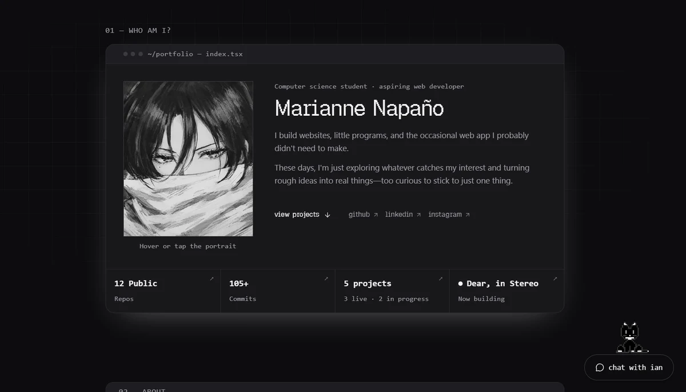

📍 Calamba, Philippines

 

## 🧣 About me

I'm a Computer Science student who enjoys building frontend and backend applications and learning new technologies.
I learn by shipping practical projects: make it, break it, fix it.

<table>
  <tr>
    <td align="center" width="33%"><b>🎓 Studying</b> Computer Science</td>
    <td align="center" width="33%"><b>🔨 Building</b> Dear, in Stereo</td>
    <td align="center" width="33%"><b>🎧 Off the clock</b> Photography · Badminton · Music · Games</td>
  </tr>
</table>

## 🛠 Tech stack

<b>Languages</b> 

<b>Frontend</b> 

<b>Backend &amp; Database</b> 

<b>Tools &amp; Platforms</b> 

## 🌐 Portfolio

 

<a href="https://iandevs.vercel.app/"><b>🔴 Live Site</b></a> &nbsp;·&nbsp; <a href="https://github.com/ifwian/Iandevsu"><b>GitHub Repository</b></a>

## 📊 GitHub stats

